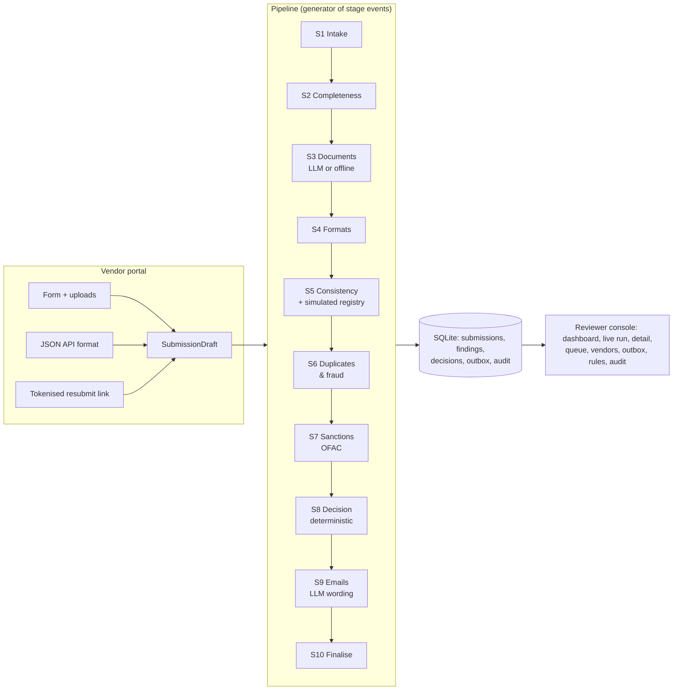

# Architecture (plain English)

## The one-paragraph version
A vendor submits a form and documents. The submission goes through a **pipeline of ten stages**. Each stage is a
plain Python function that looks at the submission and returns *findings* (rule ID, severity, evidence). The pipeline
is a **Python generator**: it `yield`s an event when each stage starts and finishes, and the Live Run page draws those
events as they happen. At the end, a **deterministic decision engine** turns the findings into APPROVED, PENDING or
REJECTED using `config/policy.yaml`. The **LLM** is used in exactly three places: reading documents, judging
borderline name pairs, and wording emails. It never makes or changes a decision. Everything is stored in **SQLite**,
including an append-only audit log.

## Why each stage uses AI or rules

| Stage | What it does | AI or rules? | Why |
|---|---|---|---|
| S1 Intake | Assign ID, store files, SHA-256 each file, audit event; on resubmission carry over unchanged documents | Rules | Bookkeeping; must be exact |
| S2 Completeness | Required fields and documents for the country and entity type; itemised list of what is missing | Rules (`policy.yaml`) | A checklist; must be predictable and explainable |
| S3 Document understanding | Is this file the document it claims to be? Extract fields with confidence and verbatim evidence | **LLM** (offline fallback) | Real documents vary in layout, are scanned, rotated or photographed. Rules cannot read a photo or recognise an unseen template; a model can. Its output is typed and evidence-backed, and only *feeds* the rules |
| S4 Format & checksum | PAN, GSTIN mod-36, IFSC, EIN prefix, ABA 3-7-1, UK sort code/account/VAT/company number | Rules | Checksums are maths. An LLM would be slower, costlier and occasionally wrong |
| S5 Consistency | Compare every ID and name across form, documents and (simulated) registry; GSTIN-embedded PAN vs declared PAN; PAN holder type vs entity; bank holder vs vendor name; letter freshness | Rules, with the **LLM only for names scoring 80-95** | Normalisation plus fuzzy scores handle "Pvt Ltd" vs "Private Limited". Only the genuinely ambiguous middle band benefits from judgement, and even then the verdict just selects a rule |
| S6 Duplicates & fraud | Identifier reuse against the vendor master, near-duplicate names, unrequested bank/tax changes on resubmission, email domain signals | Rules | Fraud rules must be auditable and repeatable |
| S7 Sanctions | Fuzzy match against the OFAC snapshot | Rules | Regulatory screening must never depend on a model's mood. Thresholds are explicit; possible matches go to a human |
| S8 Decision | Risk score and status | Rules (pure function) | The core guarantee: same input, same decision, unit-tested |
| S9 Communication | Vendor email (and internal note) to the outbox | **LLM for wording only** | Tone and clarity help vendors respond; the *content* (which items) comes from findings, and a guard rail rejects drafts that omit items or leak internals |
| S10 Finalise | Save decision, create vendor if approved, issue resubmission token, audit | Rules | Bookkeeping |

## Key modules (each is small and does one job)
- `core/pipeline/runner.py`: the generator. Runs the stages in order, times them, stores stage runs and findings,
  and turns a crashing stage into a visible `SYS-001` finding (never a silent pass).
- `core/pipeline/stages_intake.py`, `stages_checks.py`, `stages_outcome.py`: the ten stage functions.
- `core/rules.py` + `config/rules.yaml`: the rule catalogue. Stages call `make_finding("CON-002", ...)`, and severity,
  resolver and blocking come from YAML.
- `core/decision.py`: the decision engine (about 60 lines, 13 unit tests).
- `core/validators/`: one function per identifier format, each returning `Check(ok, normalized, reason, soft)`.
- `core/names.py`: name normalisation and fuzzy comparison.
- `core/sanctions.py`: snapshot loader and screener.
- `core/llm/`: the provider interface (`base.py`), Claude (`anthropic_provider.py`), Gemini (`gemini_provider.py`),
  offline rules (`offline_provider.py`), the instructions both LLMs share (`prompts.py`) and the output schemas
  (`schemas.py`, which has no decision field).
- `core/registry.py`: `RegistryClient` interface plus the simulated implementation.
- `core/comms.py`: requested items, templates, LLM-draft guard rail, delivery.
- `core/db.py`, `core/audit.py`, `core/tokens.py`, `core/seed.py`: storage, audit trail, resubmission tokens,
  idempotent startup.
- `views/*.py`: one Streamlit page each, thin. `ui/`: theme, charts, shared widgets.

## Data model (SQLite)
`submissions` (one row per attempt; `chain_id` links resubmissions) → `documents`, `stage_runs`, `findings`,
`decisions` → `outbox`, `tokens`, `review_actions`, `audit_events`, `llm_calls`; plus `vendors` (the vendor master).

## Reliability
- **LLM:** 60 s timeout, 2 retries with backoff (SDK), schema-validated output. Any failure gives S3 "degraded", the
  document is treated as unread, and the outcome is PENDING. Gemini additionally paces itself to the free-tier
  requests-per-minute limit, waits out 429s as Google instructs, and fails fast when the daily quota is gone.
- **Deterministic core:** decision engine unit tests, plus a test that the same input gives the same decision.
- **No scenario-specific code:** scenarios are just input folders with expected outcomes; tests and the smoke test
  compare.
- **Idempotent start:** `CREATE TABLE IF NOT EXISTS`, `INSERT OR IGNORE` seeding, and history replayed once
  (`meta` table flag).
- **Cost guard:** at most 8 files per submission, 4 pages per document and 20k characters of text per call; token
  usage is logged per call (`llm_calls`, dashboard tile).
- **Health page:** DB counts, provider and reachability check, sanctions snapshot date, registry label, email mode.
